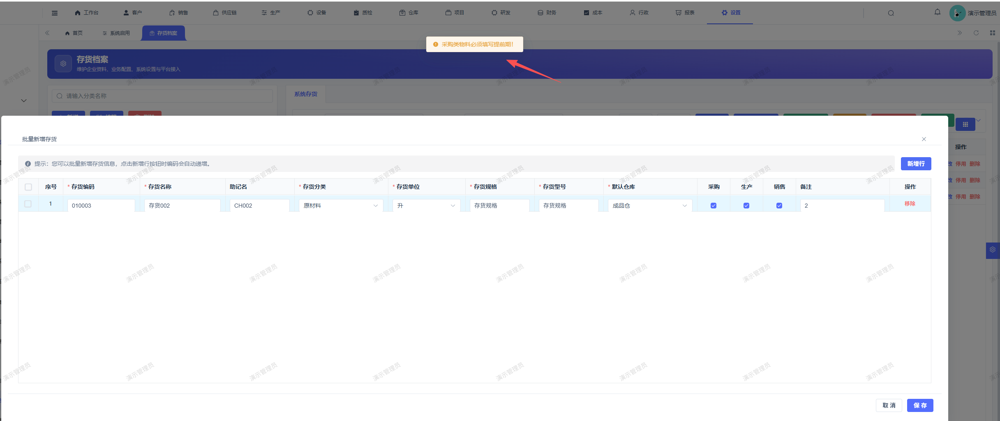

# 存货档案：批量新增存货报错 ，勾选了采购，销售，生产

- **优先级**：P2
- **模块 / 页面**：存货档案
- **测试环境**：https://jixu-ai.com/
- **提交时间**：2026-10-21 17:48:53（北京时间）
- **状态**：已发布，待验证（2026-10-21 17:58，`standard-20261021-bug-batch-1705`；补采购提前期、缓冲期及来源选择，复测按明确采购天数填写）

## 问题描述
存货档案：批量新增存货报错

## 复现步骤

## 实际结果

## 预期结果

## 截图

