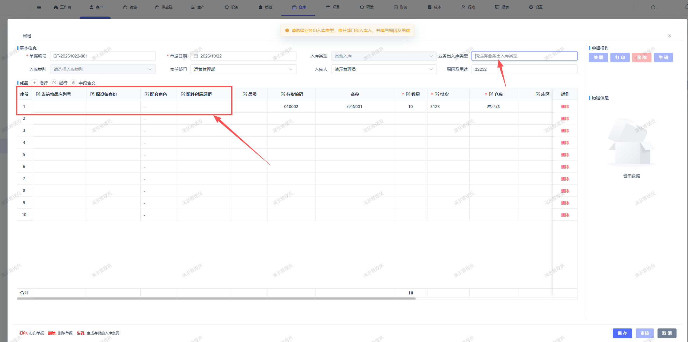

# 其他入库，新增弹窗页面，去掉多余字段

- **优先级**：P2
- **模块 / 页面**：仓库-入库管理-其他入库
- **测试环境**：https://jixu-ai.com/wireSideWarehouse/in/inOther
- **提交时间**：2026-10-22 10:43:34（北京时间）
- **状态**：已验证（2026-10-23 用户回归通过）

## 问题描述
其他入库，新增弹窗页面，去掉多余字段：当前物品序列号，原设备身份，配套角色，配件所属原柜

## 复现步骤
1.打开仓库-入库管理-其他入库
2，点击 新增 按钮

## 实际结果

## 预期结果

## 截图

## 用户回归记录

### 2026-10-23

- **来源**：用户在当前会话反馈，按 2026-10-22 七条清单顺序对应。
- **结论**：用户确认本项已好，回归通过。
- **记录**：[本轮回归汇总](REGRESSION-20261023-user-20261022-bugs.md)
