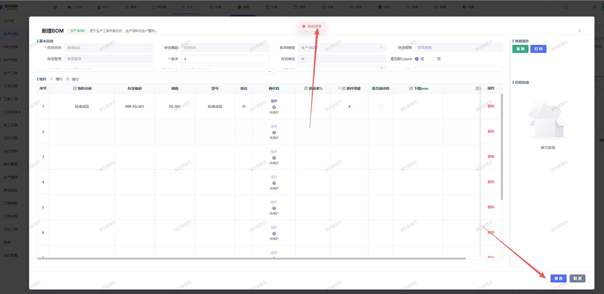
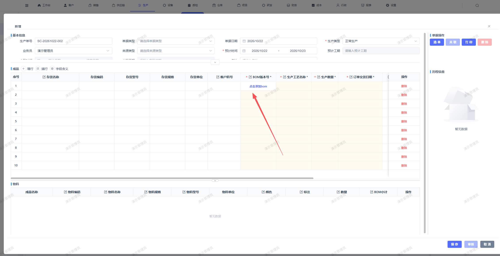

# 生产bom新增保存报错

- **优先级**：P1
- **模块 / 页面**：生产-生产计划
- **测试环境**：https://jixu-ai.com/mes/produce/order
- **提交时间**：2026-10-22 14:30:21（北京时间）
- **状态**：待修复（2026-10-23 用户回归未通过）

## 问题描述
生产bom新增保存报错

## 复现步骤
1，点击生产-生产计划
2，点击新增，在页面弹窗页面
3，点击添加bom，填写完信息后
4，点击保存

## 实际结果

## 预期结果

## 截图

## 用户回归记录

### 2026-10-23

- **来源**：用户在当前会话反馈，按 2026-10-22 七条清单顺序对应。
- **结论**：用户确认本项仍有问题，回归未通过，继续待修复。
- **记录**：[本轮回归汇总](REGRESSION-20261023-user-20261022-bugs.md)
