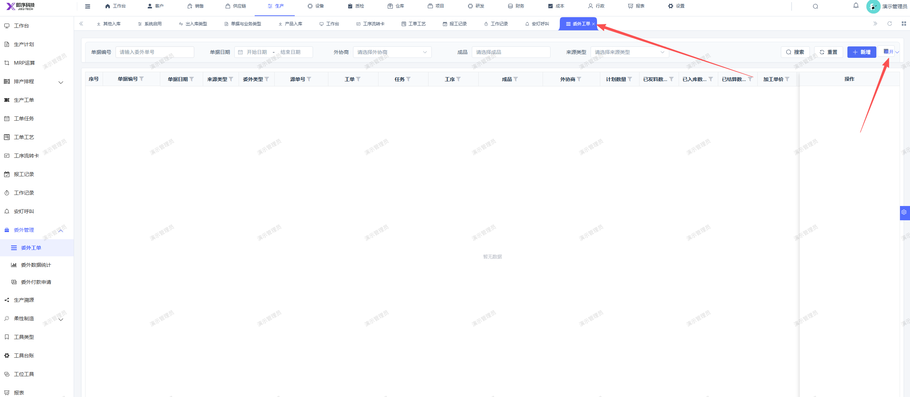
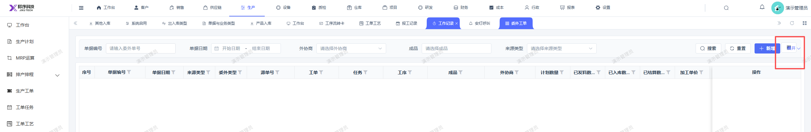

# 委外工单页面，右侧的收起和展开和图标重叠了

- **优先级**：P2
- **模块 / 页面**：生产-委外工单
- **测试环境**：https://jixu-ai.com/mes/produce/outsource/outsource-work
- **提交时间**：2026-10-22 15:19:40（北京时间）
- **状态**：待修复

## 问题描述
委外工单页面，右侧的收起和展开和图标重叠了

## 复现步骤
1点击生产
2，再点击委外工单
3，页面右侧的收起展开和图标重叠了

## 实际结果

## 预期结果

## 截图

