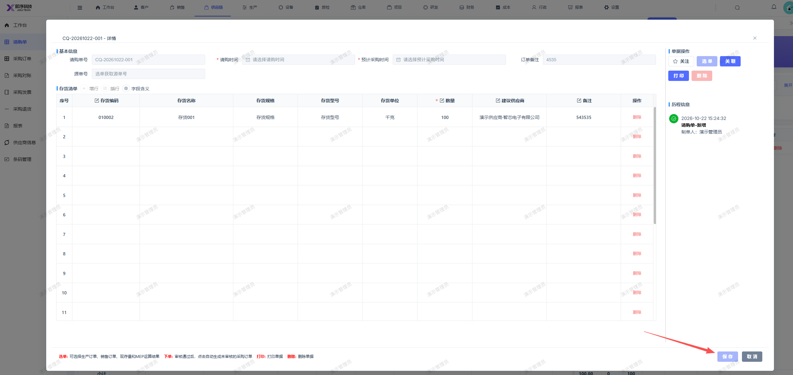

# 新增请购单保存后，保存按钮右侧应新增提审按钮，可进行提审

- **优先级**：P1
- **模块 / 页面**：供应链-请购单
- **测试环境**：https://jixu-ai.com/erp/purchase/purchaseRequest
- **提交时间**：2026-10-22 15:29:18（北京时间）
- **状态**：待修复（2026-10-23 用户回归未通过）

## 问题描述
新增请购单保存后，保存按钮右侧应新增提审按钮，可进行提审

## 复现步骤
1，点击供应链-请购单
2，点击新增，填写完弹窗内容
3，点击保存
4，保存后，右侧应新增提审按钮

## 实际结果

## 预期结果

## 截图

## 用户回归记录

### 2026-10-23

- **来源**：用户在当前会话反馈，按 2026-10-22 七条清单顺序对应。
- **结论**：用户确认本项仍有问题，回归未通过，继续待修复。
- **记录**：[本轮回归汇总](REGRESSION-20261023-user-20261022-bugs.md)
