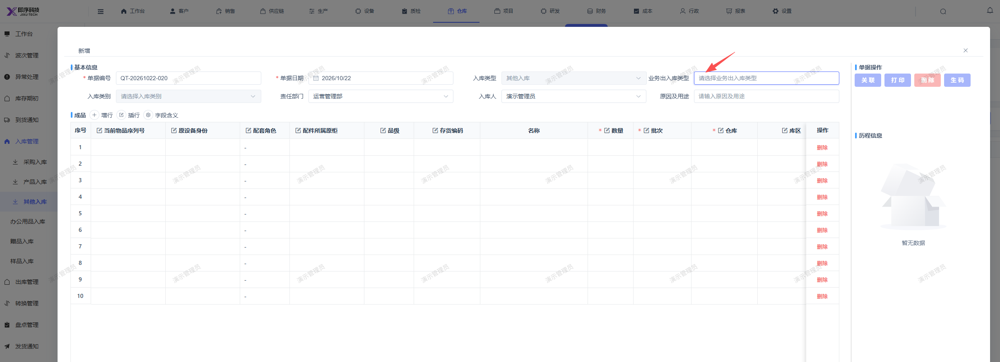

# 新建其他入库单，弹窗页面的业务出入库类型无法选择

- **优先级**：P1
- **模块 / 页面**：仓库-入库管理
- **测试环境**：https://jixu-ai.com/wireSideWarehouse/in/inOther
- **提交时间**：2026-10-22 16:44:26（北京时间）
- **状态**：待修复

## 问题描述
新建其他入库单，弹窗页面的业务出入库类型无法选择

## 复现步骤
1，点击仓库-入库管理
2，点击其他入库
3，点击 新增 弹窗页面的业务出入库类型无法选择

## 实际结果

## 预期结果

## 截图

