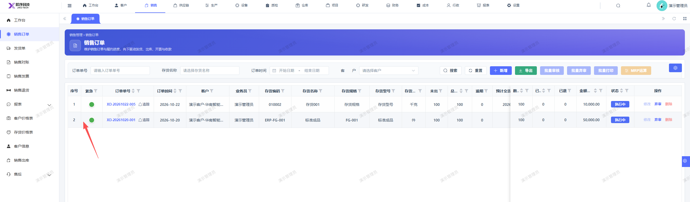

# 销售订单页面应在紧急程度前面加一个勾选框，用来勾选订单进行批量操作

- **优先级**：P2
- **模块 / 页面**：销售-销售订单
- **测试环境**：https://jixu-ai.com/erp/sale/order
- **提交时间**：2026-10-22 17:51:50（北京时间）
- **状态**：待修复

## 问题描述
销售订单页面应在紧急程度前面加一个勾选框，用来勾选订单进行批量操作，批量提审，批量弃审，批量打印

## 复现步骤
1，点击销售
2，点击销售订单
3，在页面的紧急程度前面加一个勾选框，用来勾选订单进行批量操作

## 实际结果

## 预期结果

## 截图

