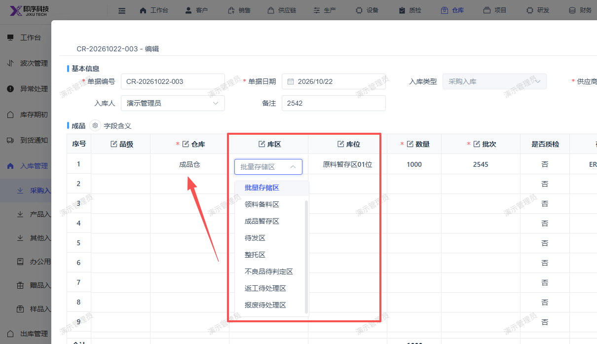

# 新建采购入库单，库区和库位应根据对应的仓库来显示，不要显示全部的库区库位

- **优先级**：P2
- **模块 / 页面**：仓库-采购入库
- **测试环境**：https://jixu-ai.com/wireSideWarehouse/in/inPurchase
- **提交时间**：2026-10-23 11:08:24（北京时间）
- **状态**：待修复

## 问题描述
新建采购入库单，库区和库位应根据对应的仓库来显示，不要显示全部的库区库位

## 复现步骤
1，点击仓库
2，点击采购管路
3，点击采购入库
4，点击新增
5，弹窗内选择对应仓库后，库区和库位应根据对应的仓库来显示，不要显示全部的库区库位

## 实际结果

## 预期结果

## 截图

