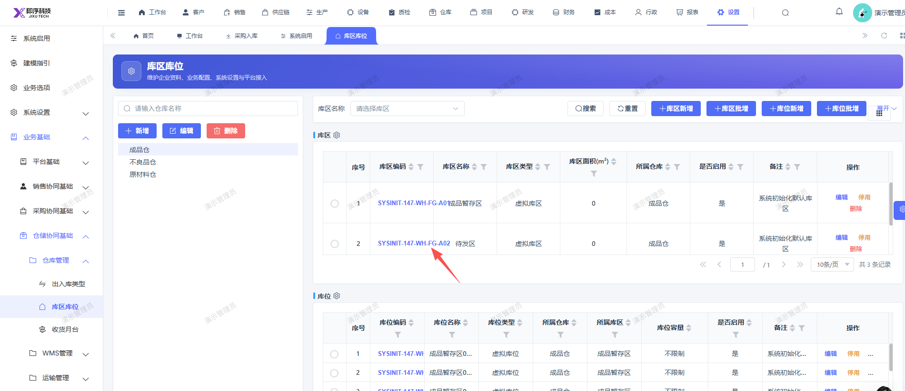

# 库区库位页面，库区编码超出框线了

- **优先级**：P2
- **模块 / 页面**：设置-业务基础-仓储协同基础
- **测试环境**：https://jixu-ai.com/settings/spec/locations
- **提交时间**：2026-10-23 11:37:24（北京时间）
- **状态**：待修复

## 问题描述
库区库位页面，库区编码超出框线了

## 复现步骤
1，点击设置
2，点击业务基础
3，点击仓储协同基础
4，仓库管理
5，点击库区库位
6，右侧的库区编码超出框线了

## 实际结果

## 预期结果

## 截图

