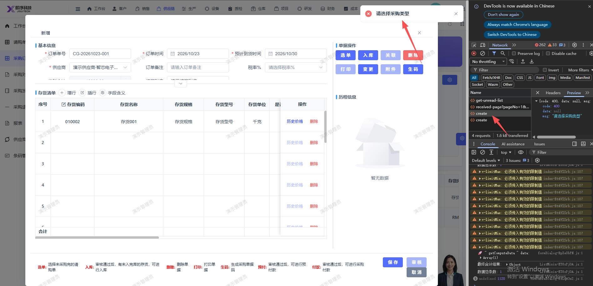

# 新建采购订单报错：  "请选择采购类型"

- **优先级**：P1
- **模块 / 页面**：供应链-采购订单
- **测试环境**：https://jixu-ai.com/erp/purchase/order
- **提交时间**：2026-10-23 14:55:27（北京时间）
- **状态**：待修复

## 问题描述
新建采购订单报错：  "请选择采购类型"

## 复现步骤
1，点击供应链
2，点击采购订单
3，点击新增，填写完弹窗内容
4，点击保存，报错：  "请选择采购类型"

## 实际结果

## 预期结果

## 截图

