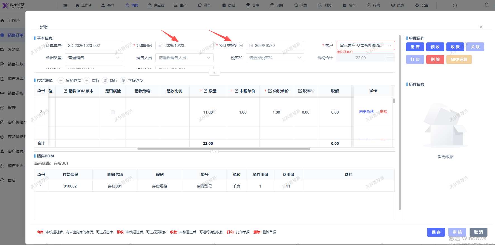
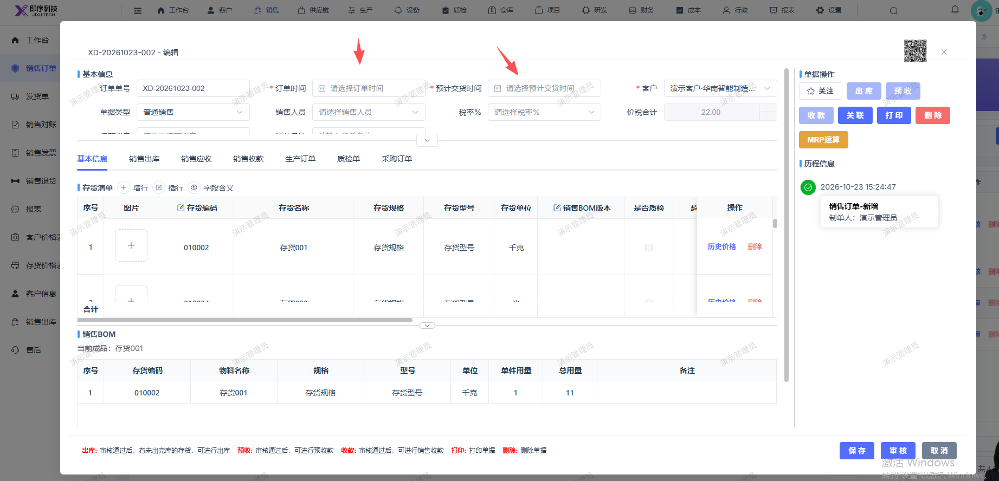

# 销售订单报错后，订单时间和预计交货时间不显示

- **优先级**：P2
- **模块 / 页面**：销售-销售订单
- **测试环境**：https://jixu-ai.com/erp/sale/order
- **提交时间**：2026-10-23 15:26:10（北京时间）
- **状态**：待修复

## 问题描述
销售订单报错后，订单时间和预计交货时间不显示

## 复现步骤
1，点击销售
2，点击销售订单
3，点击新增，填写完弹窗内容
4，点击保存，订单时间和预计交货时间不显示

## 实际结果

## 预期结果

## 截图

