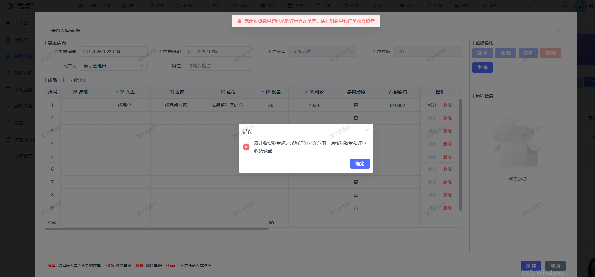

# 新增采购入库报错：累计收货数量超过采购订单允许范围，请核对数量和订单收货设置

- **优先级**：P1
- **模块 / 页面**：供应链-采购订单
- **测试环境**：https://jixu-ai.com/erp/purchase/order
- **提交时间**：2026-10-23 16:44:48（北京时间）
- **状态**：待修复

## 问题描述
新增采购入库报错：累计收货数量超过采购订单允许范围，请核对数量和订单收货设置

## 复现步骤
1，点击供应链
2，点击采购订单
3，点击CG-20261022-004订单详情，在弹窗页面
4，点击 右上角：入库
5，填写库区库位，批次
6，点击保存，报错：累计收货数量超过采购订单允许范围，请核对数量和订单收货设置

## 实际结果

## 预期结果

## 截图

