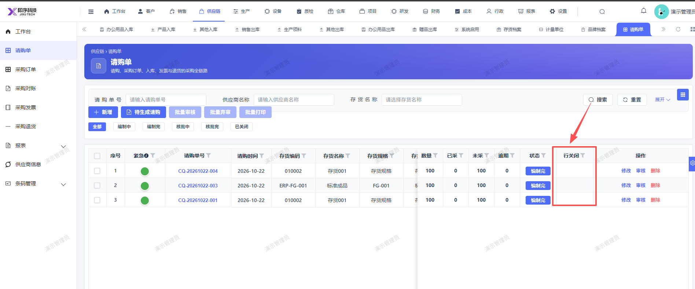

# 请购单页面的列“行关闭”显示不完整

- **优先级**：P2
- **模块 / 页面**：供应链-请购单
- **测试环境**：https://jixu-ai.com/erp/purchase/purchaseRequest
- **提交时间**：2026-10-23 17:32:15（北京时间）
- **状态**：待修复

## 问题描述
请购单页面的列“行关闭”显示不完整

## 复现步骤
1，点击供应链
2，点击请购单
3，页面的列“行关闭”显示不完整

## 实际结果

## 预期结果

## 截图

