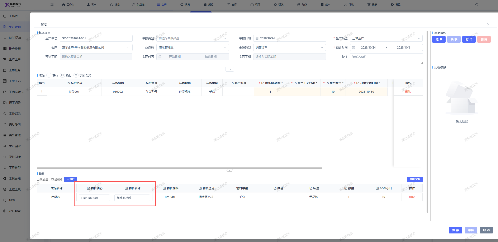

# 生产计划页面的物料明细行：物料编码和物料名称值显示样式调整，与其他字段保持一致

- **优先级**：P2
- **模块 / 页面**：生产-生产计划
- **测试环境**：https://jixu-ai.com/mes/produce/order
- **提交时间**：2026-10-24 11:23:49（北京时间）
- **状态**：待修复

## 问题描述
生产计划页面的物料明细行：物料编码和物料名称值显示样式调整，与其他字段保持一致

## 复现步骤
1，点击生产
2，点击生产计划 
3，点击新建，填写完弹窗内容
4，页面的物料明细行：物料编码和物料名称值显示样式调整，与其他字段保持一致

## 实际结果

## 预期结果

## 截图

