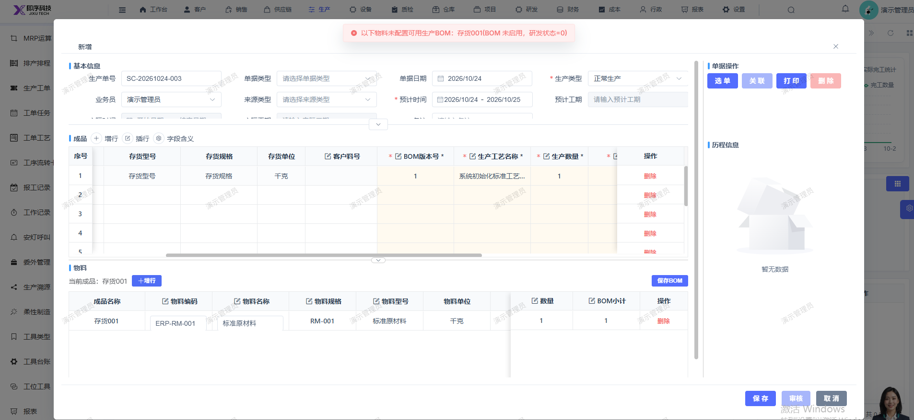

# 生产计划保存报错：以下物料未配置可用生产BOM：存货001(BOM 未启用，研发状态=0)

- **优先级**：P2
- **模块 / 页面**：生产-生产计划
- **测试环境**：https://jixu-ai.com/mes/produce/order
- **提交时间**：2026-10-24 11:31:34（北京时间）
- **状态**：待修复

## 问题描述
生产计划保存报错：以下物料未配置可用生产BOM：存货001(BOM 未启用，研发状态=0)

## 复现步骤
1，点击生产
2，点击生产计划
3，点击新增，填写完弹窗内所有信息
4，点击保存，报错：以下物料未配置可用生产BOM：存货001(BOM 未启用，研发状态=0)

## 实际结果

## 预期结果

## 截图

