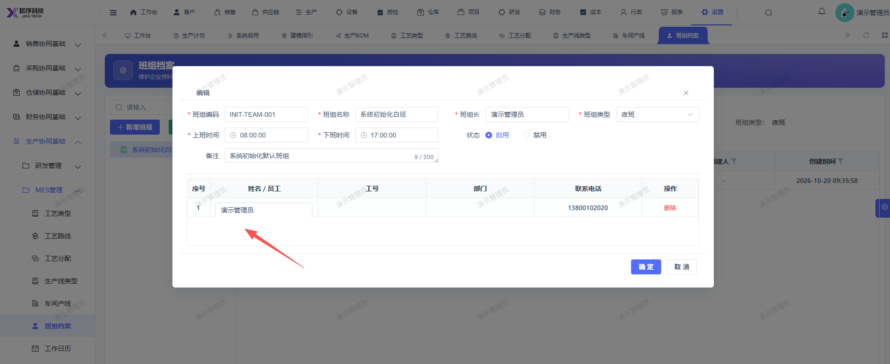

# 编辑班组，无法新增班组成员

- **优先级**：P2
- **模块 / 页面**：设置-生产协同基础-MES管理-班组档案
- **测试环境**：https://jixu-ai.com/settings/production/team
- **提交时间**：2026-10-24 11:49:44（北京时间）
- **状态**：待修复

## 问题描述
班组档案，编辑班组，无法新增班组成员

## 复现步骤
1，点击设置
2，点击生产协同基础
3，点击MES管理
4，点击班组档案
5，编辑班组，无法新增班组成员

## 实际结果

## 预期结果

## 截图

