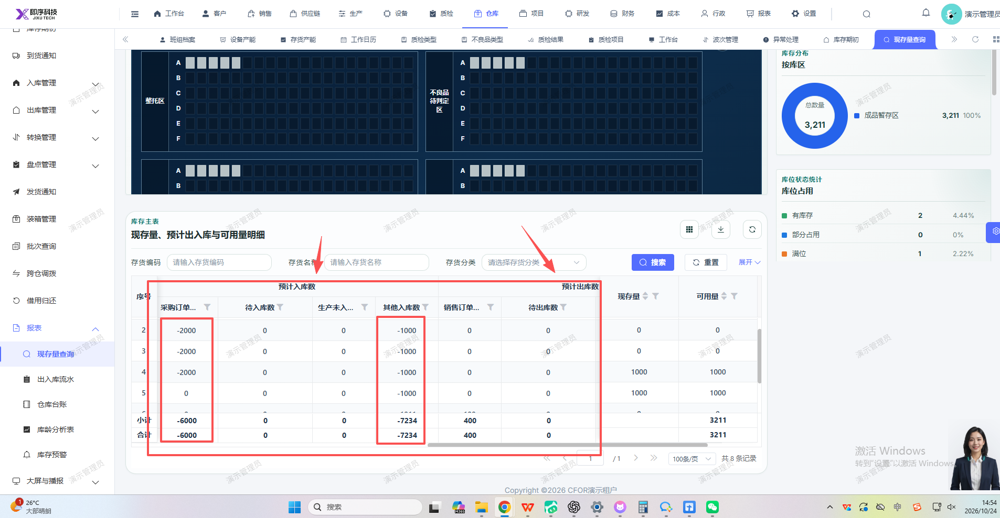

# 现存量报表的预计入库数和预计出库数不要显示负数

- **优先级**：P2
- **模块 / 页面**：仓库-报表-现存量查询
- **测试环境**：https://jixu-ai.com/wireSideWarehouse/reportForms/standingStock
- **提交时间**：2026-10-24 14:57:36（北京时间）
- **状态**：待修复

## 问题描述
现存量报表的预计入库数和预计出库数不要显示负数

## 复现步骤
1，点击仓库
2，点击报表
3，点击现存量查询
4，现存量报表的预计入库数和预计出库数不要显示负数

## 实际结果

## 预期结果

## 截图

