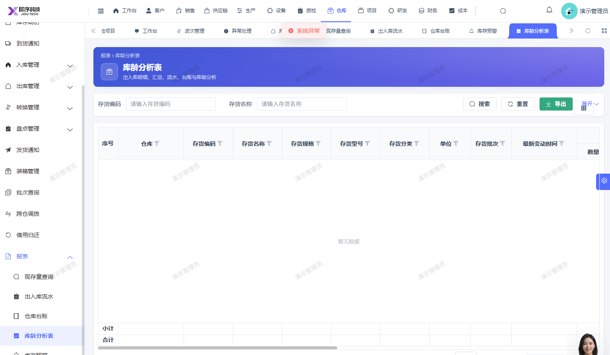

# 库龄分析表报系统异常

- **优先级**：P2
- **模块 / 页面**：仓库-报表-库龄分析表
- **测试环境**：https://jixu-ai.com/wireSideWarehouse/reportForms/inventoryAgeAnalysis
- **提交时间**：2026-10-24 16:08:47（北京时间）
- **状态**：待修复

## 问题描述
库龄分析表报系统异常

## 复现步骤
1，点击仓库
2，点击报表
3，点击库龄分析表，报系统异常

## 实际结果

## 预期结果

## 截图

