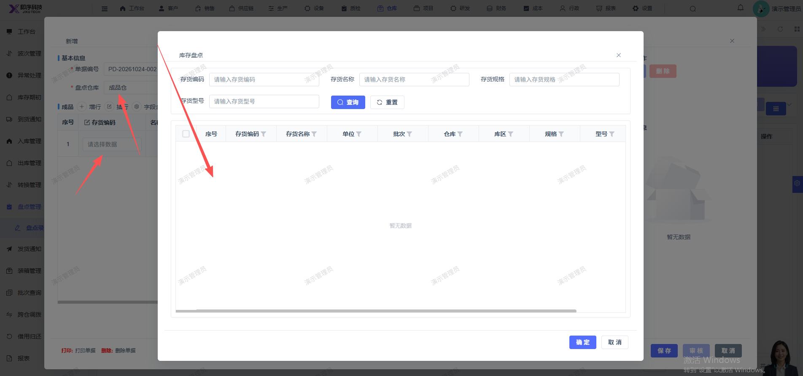

# 盘点录入，选择对应仓库后，存货列表为空，无法选择

- **优先级**：P1
- **模块 / 页面**：仓库-盘点管理-盘点录入
- **测试环境**：https://jixu-ai.com/wireSideWarehouse/checkBusiness/entries
- **提交时间**：2026-10-24 17:05:54（北京时间）
- **状态**：代码已修复，待发布

## 问题描述
盘点录入，选择对应仓库后，存货列表为空，无法选择

## 复现步骤
1，点击仓库
2，点击盘点管理
3，点击盘点录入
4，点击新增，在弹窗内选择盘点仓库：成品仓
4，点击存货编码输入框
5，弹窗页面的的存货列表为空，无法选择

## 实际结果

## 预期结果

## 截图

## 状态同步（Codex，2026-11-06）

- 产品提交：[前端 d65ca8611](http://192.168.110.240:3008/cfor_front/cfor-admin-vue3/-/commit/d65ca86119c8b7d4bc20d40861a47be182846315)
- 合入分支：dev/develop_5.0.1；本次已刷新远端并核对提交祖先关系。
- 当前结论：代码已修复，待发布；已有本地验证记录，生产发布和修复后生产复测尚无证据。
- 详细记录：[修改内容、验证及限制](reports/2026-11-06-today-bug-status-sync.md#bug-local-20261103111915-efee9490)
- 同场景报告：[BUG-local-20261103111915-efee9490](BUG-local-20261103111915-efee9490.md)、[BUG-local-20261024170554-f225f75e](BUG-local-20261024170554-f225f75e.md)；独立编号保留，共用修复说明，不视为各原账号已分别验证。
