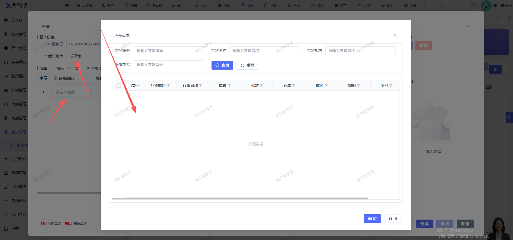

# 盘点录入，选择对应仓库后，存货列表为空，无法选择

- **优先级**：P1
- **模块 / 页面**：仓库-盘点管理-盘点录入
- **测试环境**：https://jixu-ai.com/wireSideWarehouse/checkBusiness/entries
- **提交时间**：2026-10-24 17:05:54（北京时间）
- **状态**：待修复

## 问题描述
盘点录入，选择对应仓库后，存货列表为空，无法选择

## 复现步骤
1，点击仓库
2，点击盘点管理
3，点击盘点录入
4，点击新增，在弹窗内选择盘点仓库：成品仓
4，点击存货编码输入框
5，弹窗页面的的存货列表为空，无法选择

## 实际结果

## 预期结果

## 截图

