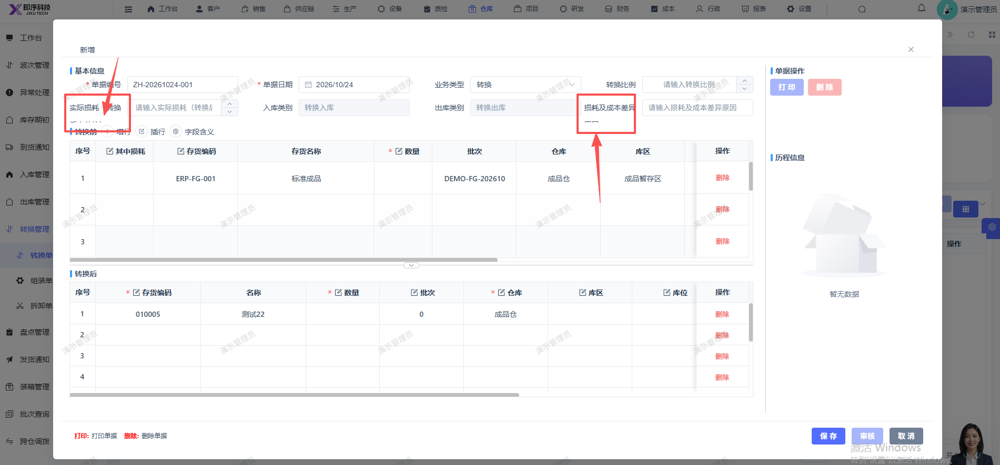

# 转换单新增页面顶部的损耗及成本差异和实际损耗 文字显示不完整，遮挡了

- **优先级**：P2
- **模块 / 页面**：仓库-转换管理-转换单
- **测试环境**：https://jixu-ai.com/wireSideWarehouse/convert/convertReceipt
- **提交时间**：2026-10-24 17:14:17（北京时间）
- **状态**：待修复

## 问题描述
转换单新增页面顶部的损耗及成本差异和实际损耗 文字显示不完整，遮挡了

## 复现步骤
1，点击仓库
2，点击转换管理
3，点击转换单
4，点击新增
5，转换单新增页面顶部的损耗及成本差异和实际损耗 文字显示不完整，遮挡了

## 实际结果

## 预期结果

## 截图

