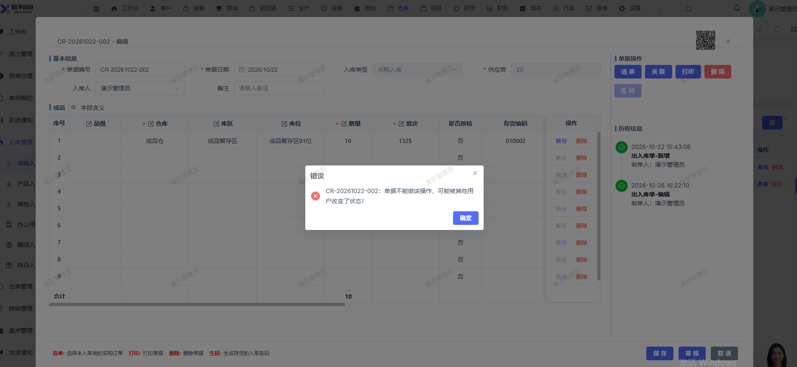

# 采购入库单据保存后再点击审核报错：CR-20261022-002：单据不能做该操作，可能被其他用户改变了状态！

- **优先级**：P1
- **模块 / 页面**：仓库-入库管理-采购入库
- **测试环境**：https://jixu-ai.com/wireSideWarehouse/in/inPurchase
- **提交时间**：2026-10-26 16:24:17（北京时间）
- **状态**：待修复

## 问题描述
新建采购入库单据保存后再点击审核报错：CR-20261022-002：单据不能做该操作，可能被其他用户改变了状态！

## 复现步骤
1，点击仓库
2，点击入库管理
3，点击采购入库
4，点击新增，在弹窗页面填写完对应信息
5，点击保存
6，点击审核，采购入库单据保存后再点击审核报错：CR-20261022-002：单据不能做该操作，可能被其他用户改变了状态！

## 实际结果

## 预期结果

## 截图

