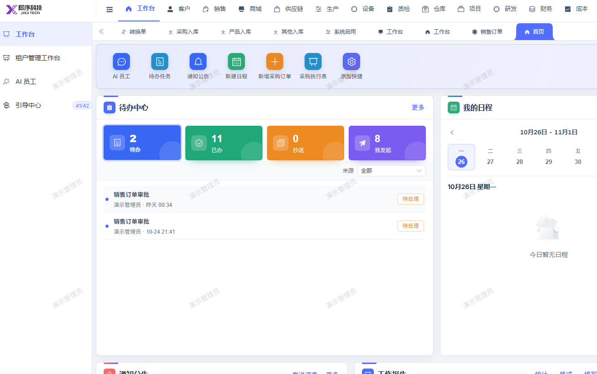
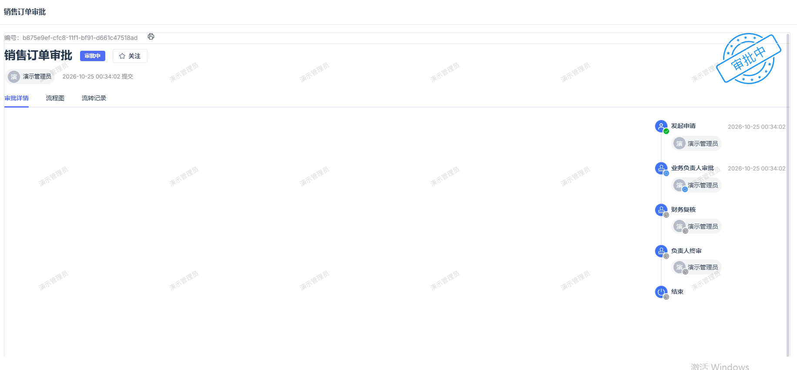

# 销售订单审核详情内容为空

- **优先级**：P2
- **模块 / 页面**：首页-工作台
- **测试环境**：https://jixu-ai.com/index
- **提交时间**：2026-10-26 17:09:19（北京时间）
- **状态**：待修复

## 问题描述
销售订单审核详情内容为空

## 复现步骤
1，点击首页
2，点击工作台
3，点击待办中心-待处理订单
3，审核详情内容为空，应有对应你内容

## 实际结果

## 预期结果

## 截图

