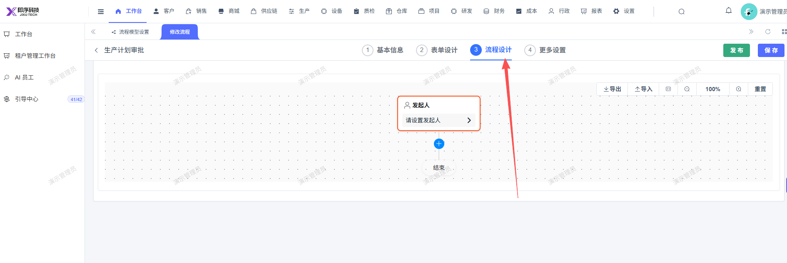

# 生产计划流程表单未配置完整，无法启用审批流

- **优先级**：P2
- **模块 / 页面**：设置-业务基础-平台基础-流程设置-流程模型设置
- **测试环境**：https://jixu-ai.com/bpm/manager/model/update/c87c3f6d-cdfa-11f1-ad09-d661c47518ad?returnTo=/settings/bpm/model-settings&step=0
- **提交时间**：2026-10-26 17:34:33（北京时间）
- **状态**：待修复

## 问题描述

## 复现步骤
1，点击设置
2，点击业务基础
3，点击平台基础
4，点击流程设置
5，点击流程模型设置
6，点击生产计划
7，点击操作：修改
8，流程表单未配置完整

## 实际结果

## 预期结果

## 截图

