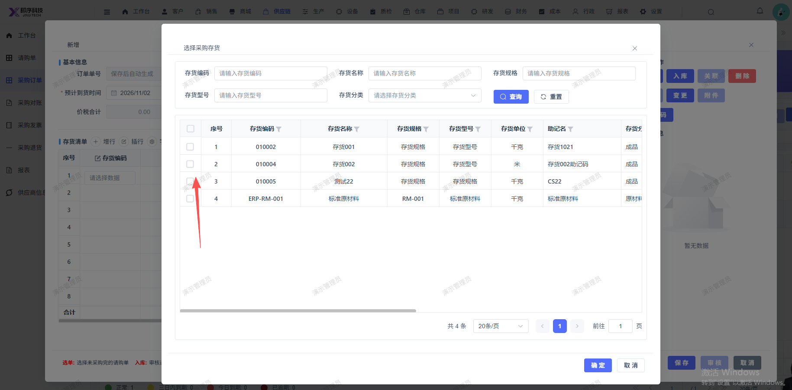
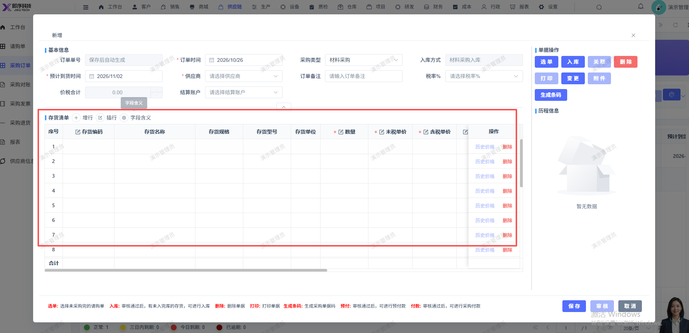

# 新建采购订单，无法选中存货；选中后 ，列表不显示对应存货

- **优先级**：P1
- **模块 / 页面**：供应链-采购订单
- **测试环境**：https://jixu-ai.com/erp/purchase/order
- **提交时间**：2026-10-26 18:00:39（北京时间）
- **状态**：待修复

## 问题描述
新建采购订单，无法选中存货，选中后 ，列表不显示对应存货

## 复现步骤
1，点击供应链
2，点击采购订单
3，点击新增
4，点击存货编码，在弹窗内选择存货：无法选中
5，选中后，列表不显示对应存货

## 实际结果

## 预期结果

## 截图

