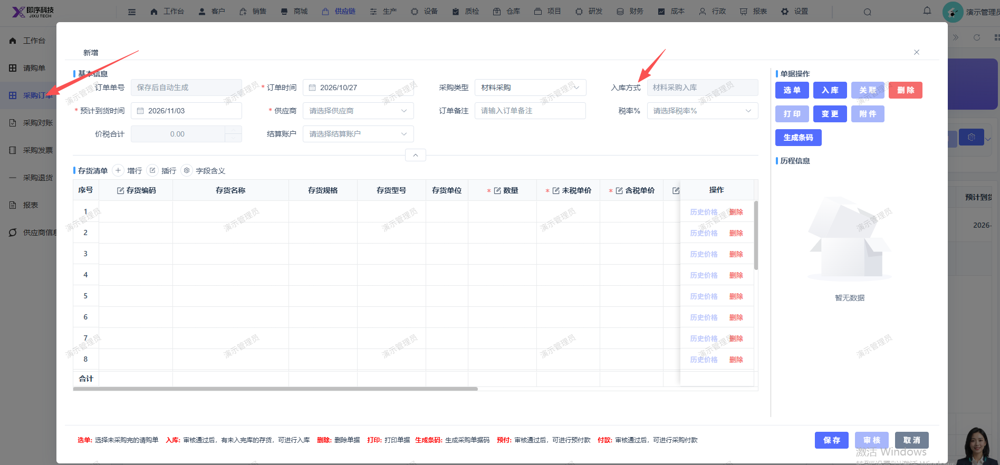

# 新增采购订单弹窗页面，去掉字段：入库方式

- **优先级**：P2
- **模块 / 页面**：供应链-采购订单
- **测试环境**：https://jixu-ai.com/erp/purchase/order
- **提交时间**：2026-10-27 10:41:15（北京时间）
- **状态**：待修复

## 问题描述
新增采购订单弹窗页面，去掉字段：入库方式

## 复现步骤
1，点击供应链
2，点击采购订单
3，点击新增，弹窗页面去掉字段：入库方式

## 实际结果

## 预期结果

## 截图

