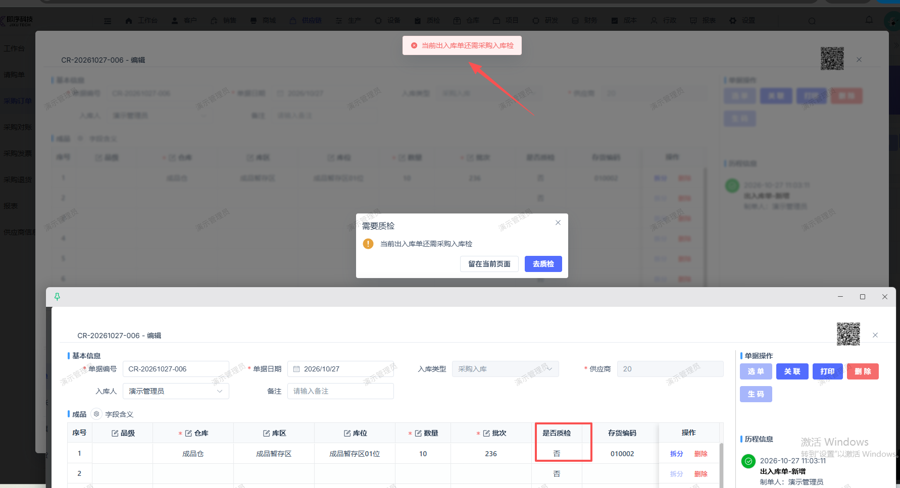
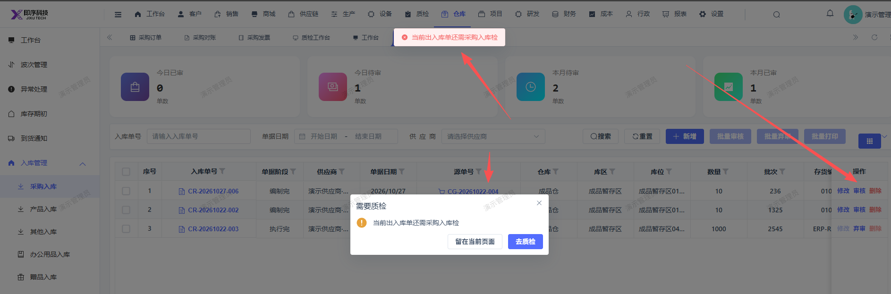

# 采购入库单未开启需要质检，提审时应不需要质检，现在会提示要去质检

- **优先级**：P2
- **模块 / 页面**：仓库-采购入库
- **测试环境**：https://jixu-ai.com/wireSideWarehouse/in/inPurchase
- **提交时间**：2026-10-27 11:34:41（北京时间）
- **状态**：代码已修复，待发布

## 问题描述
采购入库单未开启需要质检，提审时应不需要质检，现在会提示：当前出入库单还需采购入库检

## 复现步骤
1，点击仓库
2，点击入库管理
3，点击采购入库
4，点击CR-20261027-006订单的操作：审核，会报错：当前出入库单还需采购入库检

## 实际结果

## 预期结果

## 截图

## 修复记录（Codex，2026-11-06）

- 产品提交：[后端 4c1d68142](http://192.168.110.240:3008/cfor_backend/cfor-admin/-/commit/4c1d6814245dbca5e07aae1926a8e4038ac301f1)
- 合入分支：dev/develop_5.0.1
- 处理结果：代码已修复并合入开发分支，本地验证结果及限制见逐项记录；尚未核实生产发布或复测。
- 详细记录：[原因、修改及验证范围](reports/2026-11-06-merged-bug-fixes.md#bug-local-20261027113441-8cac0bc3)
