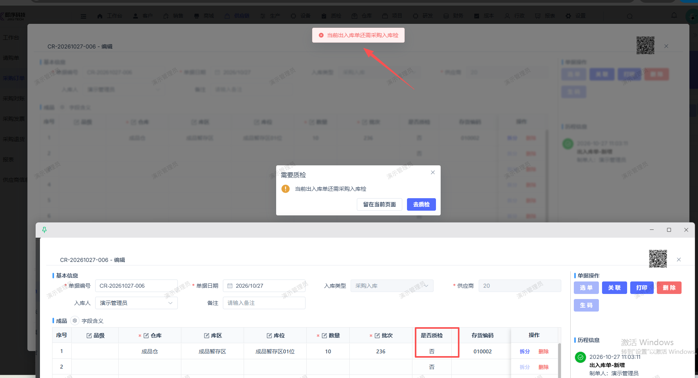
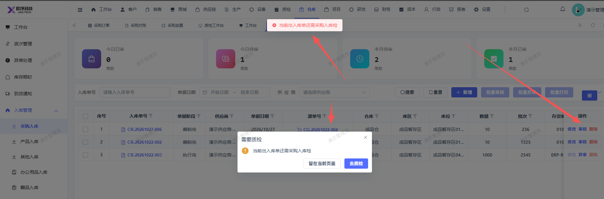

# 采购入库单未开启需要质检，提审时应不需要质检，现在会提示要去质检

- **优先级**：P2
- **模块 / 页面**：仓库-采购入库
- **测试环境**：https://jixu-ai.com/wireSideWarehouse/in/inPurchase
- **提交时间**：2026-10-27 11:34:41（北京时间）
- **状态**：待修复

## 问题描述
采购入库单未开启需要质检，提审时应不需要质检，现在会提示：当前出入库单还需采购入库检

## 复现步骤
1，点击仓库
2，点击入库管理
3，点击采购入库
4，点击CR-20261027-006订单的操作：审核，会报错：当前出入库单还需采购入库检

## 实际结果

## 预期结果

## 截图

