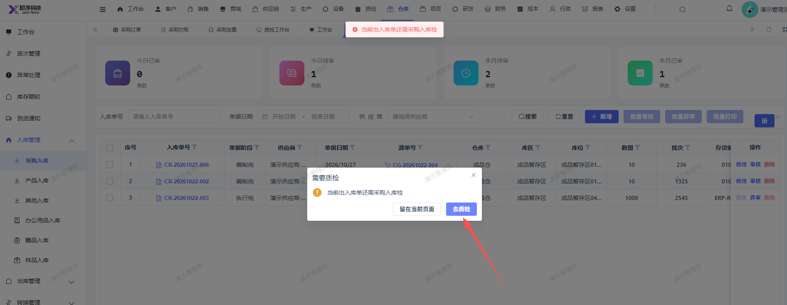
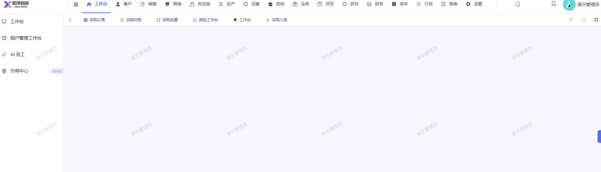

# 采购入库点击审核后弹窗内：去质检，点击后未跳转至质检页面

- **优先级**：P1
- **模块 / 页面**：
- **测试环境**：https://jixu-ai.com/wireSideWarehouse/in/inPurchase
- **提交时间**：2026-10-27 11:39:47（北京时间）
- **状态**：待修复

## 问题描述
采购入库点击审核后弹窗内：去质检，点击后未跳转至质检页面

## 复现步骤
1，点击仓库
2，点击入库管理
3，点击采购入库
4，点击入库单号：CR-20261027-006 操作栏：审核
5，点击弹窗的：去质检，未正确跳转至质检页面

## 实际结果

## 预期结果

## 截图

