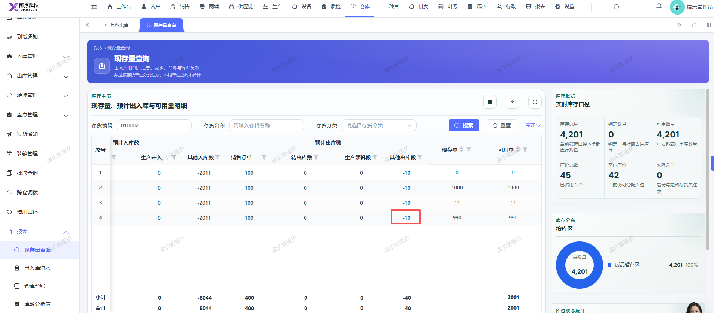

# 现存量查询报表的预计入库数和预计出库数显示，出入库已审批完成即已出库/已入库，应不显示对应的数量，直接显示0

- **优先级**：P2
- **模块 / 页面**：仓库-现存量查询
- **测试环境**：https://jixu-ai.com/wireSideWarehouse/reportForms/standingStock
- **提交时间**：2026-10-27 15:24:40（北京时间）
- **状态**：待修复

## 问题描述
现存量查询报表的预计入库数和预计出库数显示，出入库已审批完成即已出库/已入库，应不显示对应的数量，直接显示0

## 复现步骤
1，点击仓库
2，点击报表
3，点击现存量查询
4，搜索010002存货编码，库位：成品暂存区04位  的其他出库数已审核完成，已出库，对应现存量和可用量已扣减，预计出库数的其他出库应显示：0

## 实际结果

## 预期结果

## 截图

