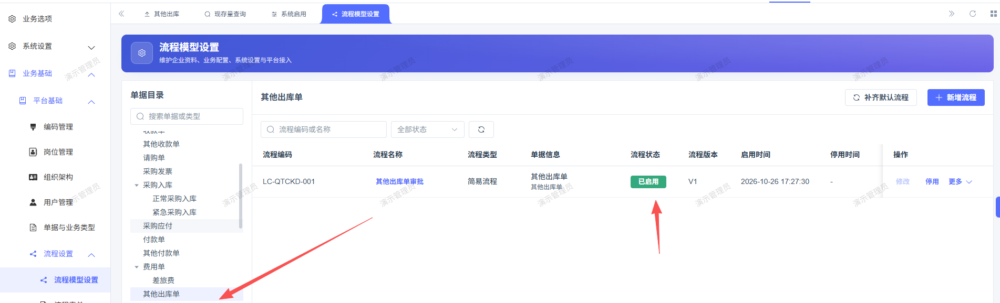
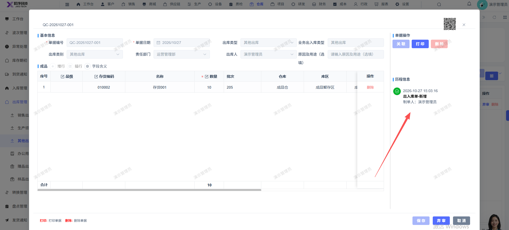

# 其他出库已开启审批流，提审未走审批流，直接审核通过了

- **优先级**：P1
- **模块 / 页面**：仓库-出库管理-其他出库
- **测试环境**：https://jixu-ai.com/wireSideWarehouse/out/outOther
- **提交时间**：2026-10-27 15:28:46（北京时间）
- **状态**：待修复

## 问题描述
其他出库已开启审批流，提审未走审批流，直接审核通过了，应走oa去审批处理后才是审核通过

## 复现步骤
1，点击仓库
2，点击出库管理
3，点击其他出库
4，点击新增，填写完弹窗内容信息点击保存；
5，再点击审核，即审核通过了：其他出库已开启审批流，提审未走审批流，直接审核通过了，应走oa去审批处理后才是审核通过

## 实际结果

## 预期结果

## 截图

