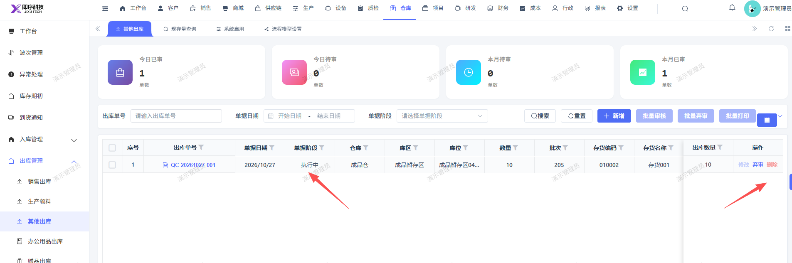

# 其他出库已审核通过，单据阶段不对，应是执行完

- **优先级**：P2
- **模块 / 页面**：仓库-出库管理-其他出库
- **测试环境**：https://jixu-ai.com/wireSideWarehouse/out/outOther
- **提交时间**：2026-10-27 15:30:32（北京时间）
- **状态**：待修复

## 问题描述
其他出库已审核通过，单据阶段不对，应是执行完

## 复现步骤
1，点击仓库
2，点击出库管理
3，点击其他出库
4，点击新增，填写完弹窗内容，点击保存
5，再点击审核，即审核通过了，状态应是执行完，不是执行中

## 实际结果

## 预期结果

## 截图

