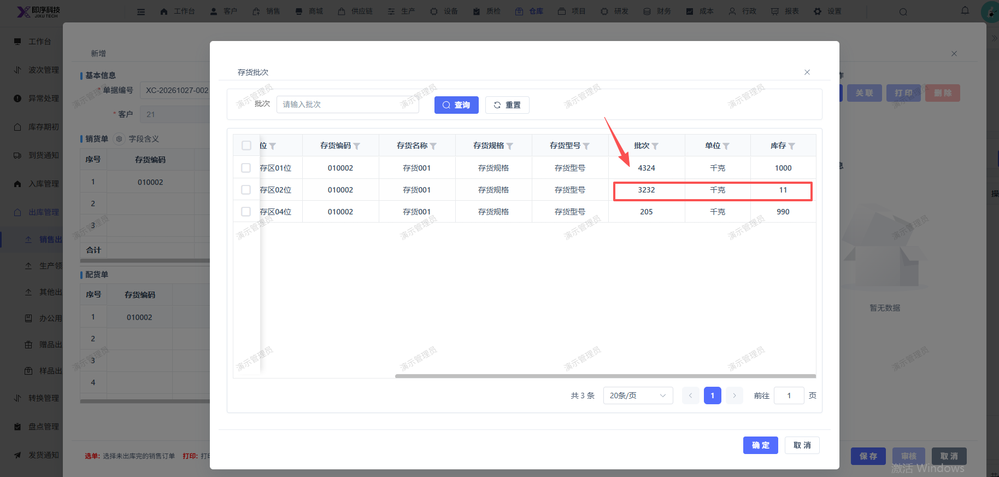
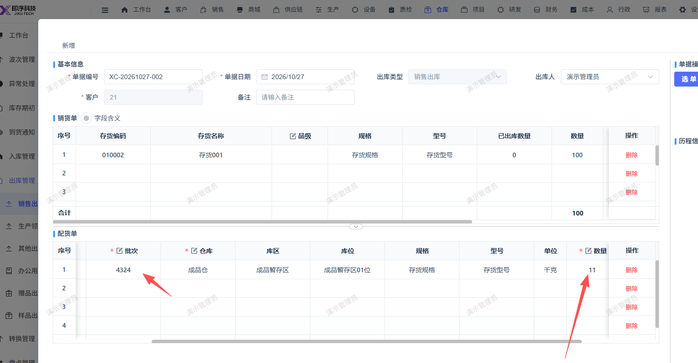

# 新建销售出库单，选择销售订单后，在配货单页面选择批次，第一次选择的批次数量不够出库，再次换一个批次后，出库数量无法调整至超过原选择批次的数量

- **优先级**：P1
- **模块 / 页面**：仓库-出库管理-销售出库
- **测试环境**：https://jixu-ai.com/wireSideWarehouse/out/outSell
- **提交时间**：2026-10-27 16:38:25（北京时间）
- **状态**：待修复

## 问题描述
新建销售出库单，选择销售订单后，在配货单页面选择批次，第一次选择的批次数量不够出库，再次换一个批次后，出库数量无法调整至超过原选择批次的数量

## 复现步骤
1，点击仓库
2，点击出库管理
3，点击销售出库
4，点击新增，在弹窗内选择对应的销售订单XD-20261022-005
5，在配货单页面选择批次，第一次选择的批次数量不够出库，再次换一个批次后，出库数量无法调整至超过原选择批次的数量

## 实际结果

## 预期结果

## 截图

