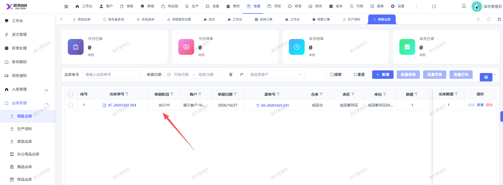

# 销售出库单审核通过后，列表显示单据阶段不对，应是执行完

- **优先级**：P2
- **模块 / 页面**：仓库-出库管理-销售出库
- **测试环境**：https://jixu-ai.com/wireSideWarehouse/out/outSell
- **提交时间**：2026-10-27 16:49:24（北京时间）
- **状态**：待修复

## 问题描述
销售出库单审核通过后，单据阶段不对，应是执行完

> **修复提示（2026-11-07 复现确认）**：本条为**配置导致**，非代码缺陷。在“单据选项配置”（/mes/base/bill-options）把 MesStkIo 的“自动结束执行”由“否”改为“是”即可。**不要修改审批/执行代码**（影响全部出入库单据）。该配置**作用于全部出入库单，不只是销售出库**，上线前需业务确认接受这一范围；「执行完自动关闭」仍为「否」，**不会因此关闭单据**。配置只对之后新审核的单据生效，已停在“执行中”的旧单需弃审后重新审核。详见 bug-triage/BUG-local-20261027164924-ae255170.reproduction.md。

## 复现步骤
1，点击仓库
2，点击出库管理
3，点击销售出库
4，点击新增，在弹窗内填完信息，点击保存，再点击审核
5，列表的的出库单的单据阶段不对，应是执行完

## 实际结果

## 预期结果

## 截图

## 状态同步（Qoder，2026-11-10）：配置类结论，状态保持待修复

- 产品提交：无。本条不登记任何修复提交；本轮未改配置、未改代码。
- 定因：销售出库单审核后 `billStage=32`（执行中）而非 34（执行完）。单据选项配置中平台兜底的出入库单 `MesStkIo`「自动结束执行=否」，审批后的执行链路只按该开关决定是否写 34，而出入库单又没有手动「结束执行」入口，因此永远到不了执行完。只读代码核对：`BillServiceImpl` 的 `refreshExecuteStage` 只有「未配置单据选项」或「自动结束执行=是」才写 34，本例 `isAutoEndExecute=0` 故保持 32；出入库单未重写 `hasFinishedExecute`，基类口径 stage >= 32 即执行完，**业务动作本身已完成，只差阶段收尾**。
- 唯一处置：在「单据选项配置」（`/mes/base/bill-options`）把 `MesStkIo` 的「自动结束执行」由「否」改为「是」。
- 必须保留的限制：1）**不要为此修改审批/执行代码**（`StkIoServiceImpl`、`BillServiceImpl`、`refreshExecuteStage` 等），这些是平台共用逻辑，改代码会同时影响采购入库、生产领料、其他出入库等全部出入库单据；2）该配置**作用于全部出入库单，不只是销售出库**，上线前需业务确认接受这一范围；3）配置改完**只影响之后新审核的单据**，已停在「执行中」的旧单需弃审后重新审核；4）「执行完自动关闭」仍为「否」，**不会因此关闭单据**；5）本轮按复现要求未改配置、未改代码。
- 复现口径说明：报告步骤的「新增→保存→审核」未能原样走通（选单「仅展示可出库的销售订单」当前 0 条），改为对同等已审核单据 XC-20261107-003 做「弃审→保存→审核」，审核动作、审批回调与阶段变化与新增是同一条链路，判断有效。本地数据变动保留：该单最终阶段与复现前相同，审批时间等元数据更新；另尝试新建的销售订单 XD-20261107-003 已落库（核批中、价税合计 0），为构造出库单的中间产物。
- 线上核对：jixu-ai.com 同页面多张已审核销售出库单（XC-20261028-009/008/007、XC-20261027-004 等）同样显示「执行中」，与本地一致，线上只读未做写操作。
- 当前结论：待修复（已定因为配置口径，处置需业务确认）；无生产发布证据。
- 详细记录：[定因、处置与限制](reports/2026-11-10-bug-status-sync.md#bug-local-20261027164924-ae255170)
