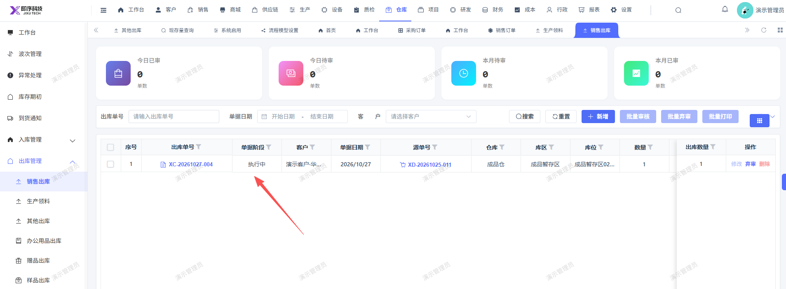

# 销售出库单审核通过后，列表显示单据阶段不对，应是执行完

- **优先级**：P2
- **模块 / 页面**：仓库-出库管理-销售出库
- **测试环境**：https://jixu-ai.com/wireSideWarehouse/out/outSell
- **提交时间**：2026-10-27 16:49:24（北京时间）
- **状态**：待修复

## 问题描述
销售出库单审核通过后，单据阶段不对，应是执行完

## 复现步骤
1，点击仓库
2，点击出库管理
3，点击销售出库
4，点击新增，在弹窗内填完信息，点击保存，再点击审核
5，列表的的出库单的单据阶段不对，应是执行完

## 实际结果

## 预期结果

## 截图

