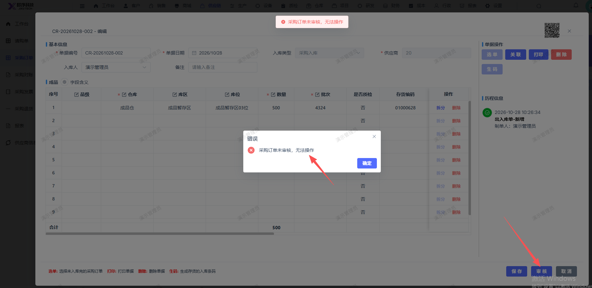
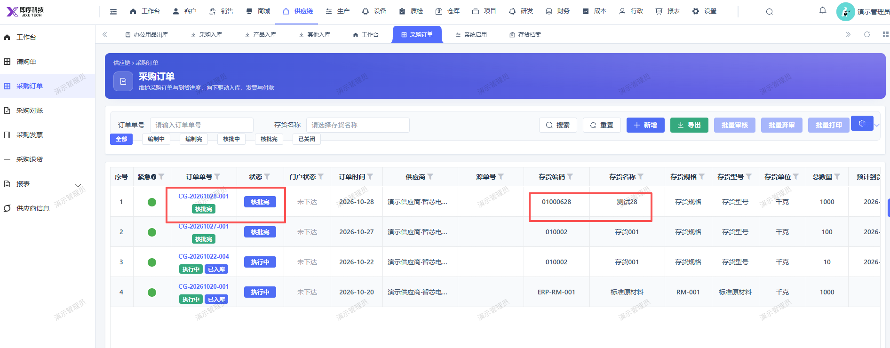

# 采购入库审核报错：采购订单未审核，无法操作

- **优先级**：P1
- **模块 / 页面**：仓库-入库管理-采购入库
- **测试环境**：https://jixu-ai.com/wireSideWarehouse/in/inPurchase
- **提交时间**：2026-10-28 10:28:59（北京时间）
- **状态**：待修复

## 问题描述
采购入库审核报错：采购订单未审核，无法操作；对应采购订单实际已审核

## 复现步骤
1，点击仓库
2，点击入库管理
3，点击采购入库
4，点击CR-20261028-002，右侧操作栏：审核，报错：采购订单未审核，无法操作

## 实际结果

## 预期结果

## 截图

