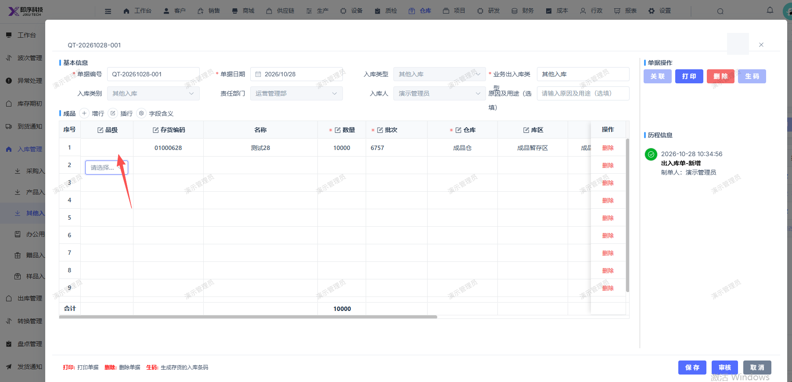

# 其他入库存货01000628，开启了品级管理，选择品级，保存后不显示对应评级

- **优先级**：P2
- **模块 / 页面**：仓库-入库管理-其他入库
- **测试环境**：https://jixu-ai.com/wireSideWarehouse/in/inOther
- **提交时间**：2026-10-28 10:36:43（北京时间）
- **状态**：待修复

## 问题描述
其他入库存货01000628，开启了品级管理，选择品级，保存后不显示对应评级

## 复现步骤
1，点击仓库
2，点击入库管理
3，点击其他入库
4，点击新增，填写完弹窗内容后
5，点击保存，弹窗页面的品级不显示

## 实际结果

## 预期结果

## 截图

