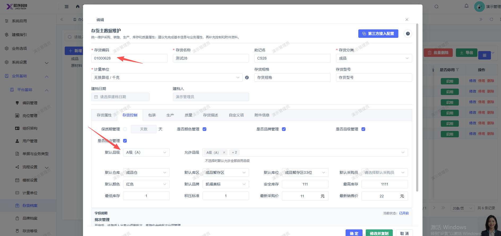
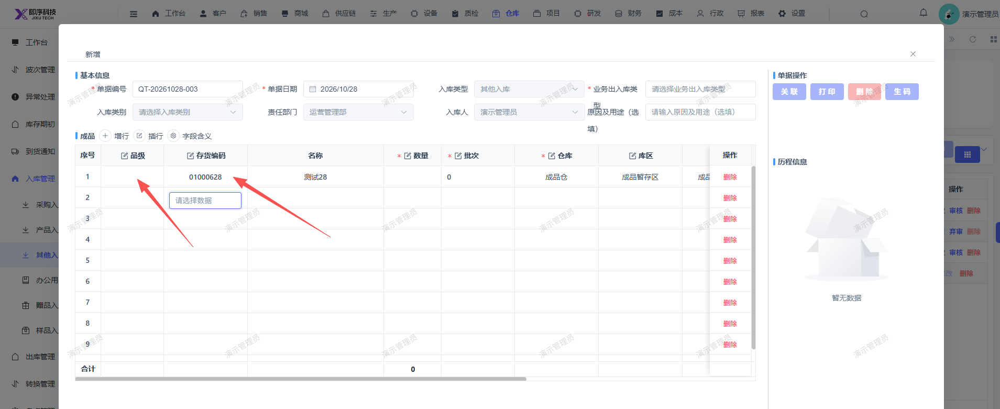

# 新增其他入库单，选择开启品级管理的存货，选中后未显示默认品级

- **优先级**：P2
- **模块 / 页面**：仓库-入库管理-其他入库
- **测试环境**：https://jixu-ai.com/wireSideWarehouse/in/inOther
- **提交时间**：2026-10-28 10:47:03（北京时间）
- **状态**：代码已修复，待发布

## 问题描述
新增其他入库单，选择开启品级管理的存货，选中后未显示默认品级

## 复现步骤
1，点击仓库
2，点击入库管理
3，点击其他入库
4，点击新增，点击存货编码选择01000628后点击确定，列表品级未显示默认品级

## 实际结果

## 预期结果

## 截图

## 状态同步（Qoder，2026-11-10）

- 产品提交：[前端 20a527226](http://192.168.110.240:3008/cfor_front/cfor-admin-vue3/-/commit/20a5272264d874eed20a9e8ff4431a750c33e92d)
- 合入分支：dev/develop_5.0.1；本次已刷新远端并核对提交祖先关系。
- 原因：存货弹窗接口已把 `defaultGradeId` 带到行数据，但其他入库 `formDialog.vue` 的 `popupChange` 只带入默认仓库、库区、库位与批次 0，未写 `gradeId`/`gradeId_dictText`，静态列与编辑器都取不到值。
- 修改：仅改该文件 3 行新增，品级管理存货（`gradeManaged === 'Y'` 且 `defaultGradeId` 非空）带入默认品级，未配置时留空由用户选择。
- 既有验证及限制（证据缺口）：**没有修复后复测记录，也没有修复后截图或 DOM 产物**，依据为已合入的代码改动与复现阶段的只读定位，不声称复测通过。静态品级文字依赖同批 `f8f5095d7` 的 `grade_display` 插槽，两个提交均已合入。复现前置给本地测试存货 BUG-371AE9E0 设置的默认品级 A级（A）保留在本地；新增单据未保存，无入库数据。线上只读确认原存货 01000628 确有默认品级 A级（A），但弹窗「确定」在合成点击下不响应，未在线上完成「选中→看品级列」，线上无写操作。**影响范围仅其他入库**，不覆盖库存期初等缺品级录入字段的场景。
- 当前结论：代码已修复，待发布；尚无生产发布或修复后生产复测证据。
- 详细记录：[修改内容、验证及限制](reports/2026-11-10-bug-status-sync.md#bug-local-20261028104703-62d36a4c)
