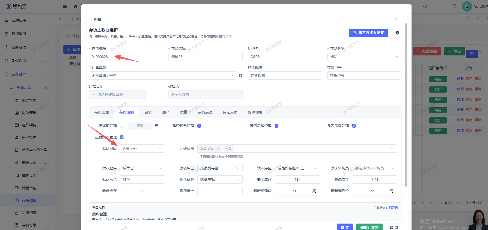
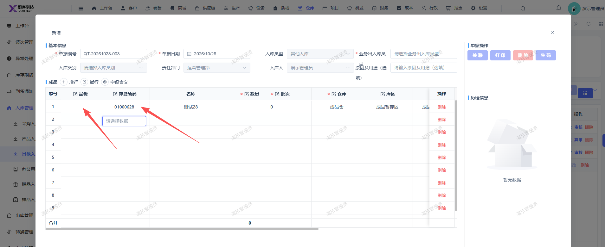

# 新增其他入库单，选择开启品级管理的存货，选中后未显示默认品级

- **优先级**：P2
- **模块 / 页面**：仓库-入库管理-其他入库
- **测试环境**：https://jixu-ai.com/wireSideWarehouse/in/inOther
- **提交时间**：2026-10-28 10:47:03（北京时间）
- **状态**：待修复

## 问题描述
新增其他入库单，选择开启品级管理的存货，选中后未显示默认品级

## 复现步骤
1，点击仓库
2，点击入库管理
3，点击其他入库
4，点击新增，点击存货编码选择01000628后点击确定，列表品级未显示默认品级

## 实际结果

## 预期结果

## 截图

