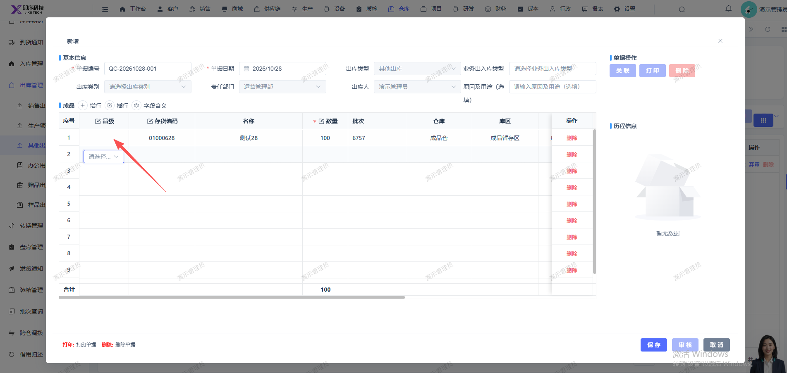
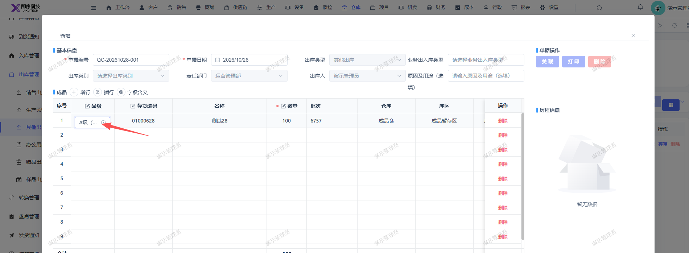

# 新增其他出库单，选择对应的存货后，品级不显示（点击品级处会显示，鼠标移开不显示）

- **优先级**：P2
- **模块 / 页面**：仓库-出库管理-其他出库
- **测试环境**：https://jixu-ai.com/wireSideWarehouse/out/outOther
- **提交时间**：2026-10-28 11:01:39（北京时间）
- **状态**：待修复

## 问题描述
新增其他出库单，选择对应的存货后，品级不显示（点击品级处会显示，鼠标移开不显示）

## 复现步骤
1，点击仓库
2，点击出库管理
3，点击其他出库
4，点击新增，在弹窗内选择存货编码01000628，点击确定
5，弹窗内的品级不显示：点击品级处会显示，鼠标移开不显示

## 实际结果

## 预期结果

## 截图

