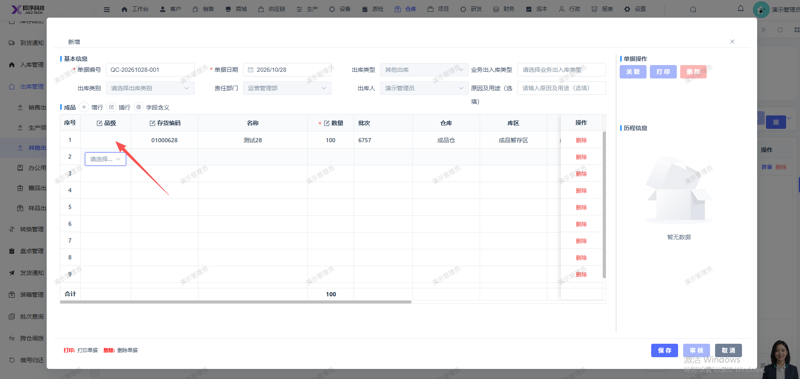
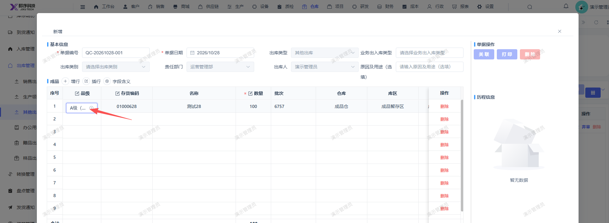

# 新增其他出库单，选择对应的存货后，品级不显示（点击品级处会显示，鼠标移开不显示）

- **优先级**：P2
- **模块 / 页面**：仓库-出库管理-其他出库
- **测试环境**：https://jixu-ai.com/wireSideWarehouse/out/outOther
- **提交时间**：2026-10-28 11:01:39（北京时间）
- **状态**：代码已修复，待发布

## 问题描述
新增其他出库单，选择对应的存货后，品级不显示（点击品级处会显示，鼠标移开不显示）

## 复现步骤
1，点击仓库
2，点击出库管理
3，点击其他出库
4，点击新增，在弹窗内选择存货编码01000628，点击确定
5，弹窗内的品级不显示：点击品级处会显示，鼠标移开不显示

## 实际结果

## 预期结果

## 截图

## 状态同步（Qoder，2026-11-10）

- 产品提交：[前端 f8f5095d7](http://192.168.110.240:3008/cfor_front/cfor-admin-vue3/-/commit/f8f5095d7f8f01f0f80cc7962fbb18054f4b5607)
- 合入分支：dev/develop_5.0.1；本次已刷新远端并核对提交祖先关系。
- 原因：静态品级列读 `gradeId_dictText`，该文本仅在用户触发 `update:value` 时写入；库存选择回调带入库存数据未补齐品级标签，后端 `MesStkInventory.gradeId` 也无 `@Dict` 翻译注解。编辑器按 `gradeId` 解析标签，故进入编辑可见、退出即空白。
- 修改：仅改 `src/components/VxeTable/src/VxeTableDialog.vue`，新增 `grade_display` 插槽与 `getGradeLabel(row)`，对 `grade_select` 列补默认静态插槽；标签优先取 `gradeId_dictText`，否则按 `gradeId` 字符串匹配 `gradeOptions`。
- 既有验证及限制（证据缺口）：复现记录完整，但**没有修复与复测文字段落**；修复后产物只有一张截图 `bug-2efbf79b-fixed-grade.png` 与内容为堆内存不足崩溃栈的 `bug-2efbf79b-typecheck.txt`。本条依据是已合入的代码改动加一张修复后截图，不声称有可审查的逐步浏览器复测记录，也不声称类型检查通过。原报告存货 01000628 不在本地，复现使用等价测试存货 BUG-371AE9E0。为构造复现创建并审核的其他入库 QT-20261107-002 保留在本地；其他出库新增未保存、未审核，无出库扣减。
- 当前结论：代码已修复，待发布；尚无生产发布或修复后生产复测证据。
- 详细记录：[修改内容、验证及限制](reports/2026-11-10-bug-status-sync.md#bug-local-20261028110139-2efbf79b)
