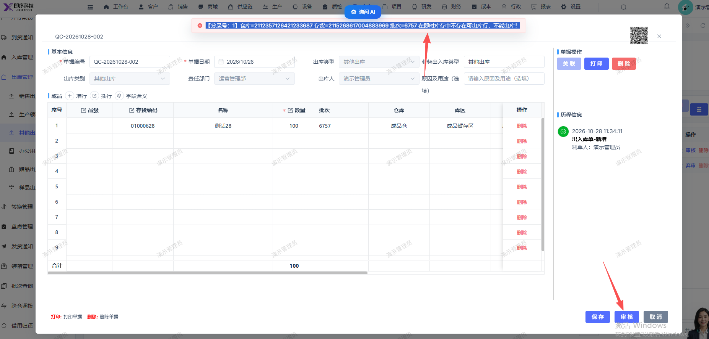

# 其他出库提审报错：【分录号：1】仓库=2112357126421233687 存货=2115268617004883969 批次=6757 在即时库存中不存在可出库行，不能出库！

- **优先级**：P1
- **模块 / 页面**：仓库-出库管理-其他出库
- **测试环境**：https://jixu-ai.com/wireSideWarehouse/out/outOther
- **提交时间**：2026-10-28 11:36:27（北京时间）
- **状态**：待修复

## 问题描述
其他出库提审报错：【分录号：1】仓库=2112357126421233687 存货=2115268617004883969 批次=6757 在即时库存中不存在可出库行，不能出库！

## 复现步骤
1，点击仓库
2，点击出库管理
3，点击其他出库
4，点击新增，在弹窗内填写完信息，选择存货：01000628，点击确定后
5，在弹窗内点击保存，再点击审核报错：【分录号：1】仓库=2112357126421233687 存货=2115268617004883969 批次=6757 在即时库存中不存在可出库行，不能出库！

## 实际结果

## 预期结果

## 截图

