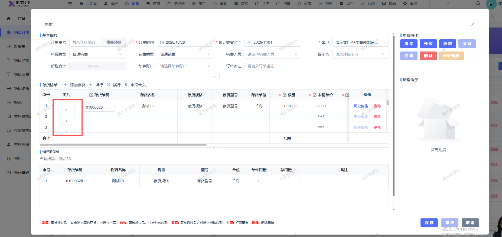

# 销售订单新增和详情页面的上传图片处的宽线+号展示不全

- **优先级**：P2
- **模块 / 页面**：销售-销售订单
- **测试环境**：https://jixu-ai.com/erp/sale/order
- **提交时间**：2026-10-28 15:53:35（北京时间）
- **状态**：待修复

## 问题描述
销售订单新增和详情页面的上传图片处的宽线+号展示不全

## 复现步骤
1，点击销售
2，点击销售订单
3，点击新增，新增和详情页面的上传图片处的宽线+号展示不全

## 实际结果

## 预期结果

## 截图

