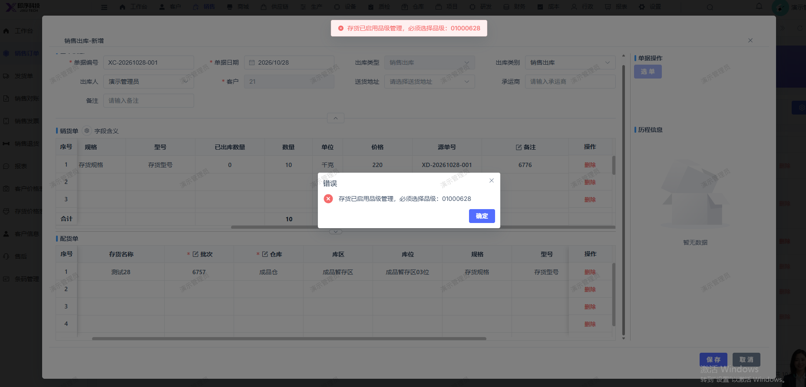

# 销售出库单无法保存 ，保存报错：存货已启用品级管理，必须选择品级：01000628

- **优先级**：P1
- **模块 / 页面**：仓库-出库管理-销售出库
- **测试环境**：https://jixu-ai.com/wireSideWarehouse/out/outSell
- **提交时间**：2026-10-28 16:04:36（北京时间）
- **状态**：待修复

## 问题描述
销售出库单无法保存 ，保存报错：存货已启用品级管理，必须选择品级：01000628

## 复现步骤
1，点击仓库
2，点击出库管理
3，点击销售出库
4，点击新增，选中销售订单：XD-20261028-001 ，
5，在弹窗内选择批次6757，点击保存，报错：销售出库单无法保存 ，保存报错：存货已启用品级管理，必须选择品级：01000628

## 实际结果

## 预期结果

## 截图

