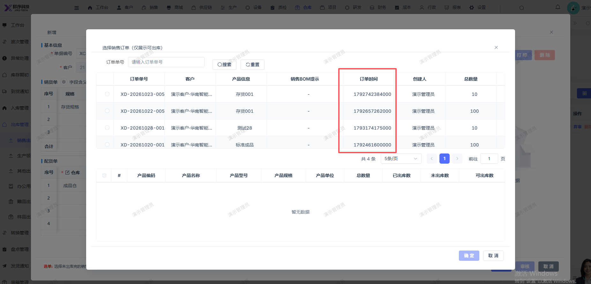

# 新建销售出库单，选择销售订单的弹窗页面的订单时间未正确显示，限制显示的是时间戳

- **优先级**：P2
- **模块 / 页面**：仓库-出库管理-销售出库
- **测试环境**：https://jixu-ai.com/wireSideWarehouse/out/outSell
- **提交时间**：2026-10-28 16:17:41（北京时间）
- **状态**：待修复

## 问题描述
新建销售出库单，选择销售订单的弹窗页面的订单时间未正确显示，限制显示的是时间戳

## 复现步骤
1，点击仓库
2，点击出库管理
3，点击销售出库
4，点击新增，在弹窗右上角点击：选单
5，弹窗页面的订单时间未正确显示，限制显示的是时间戳

## 实际结果

## 预期结果

## 截图

