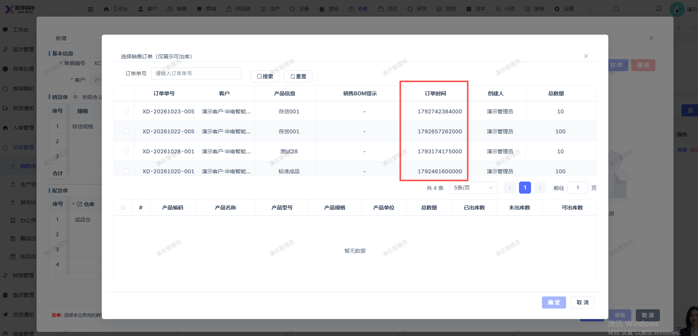

# 新建销售出库单，选择销售订单的弹窗页面的订单时间未正确显示，限制显示的是时间戳

- **优先级**：P2
- **模块 / 页面**：仓库-出库管理-销售出库
- **测试环境**：https://jixu-ai.com/wireSideWarehouse/out/outSell
- **提交时间**：2026-10-28 16:17:41（北京时间）
- **状态**：代码已修复，待发布

## 问题描述
新建销售出库单，选择销售订单的弹窗页面的订单时间未正确显示，限制显示的是时间戳

## 复现步骤
1，点击仓库
2，点击出库管理
3，点击销售出库
4，点击新增，在弹窗右上角点击：选单
5，弹窗页面的订单时间未正确显示，限制显示的是时间戳

## 实际结果

## 预期结果

## 截图

## 状态同步（Qoder，2026-11-10）

- 产品提交：[前端 9aac17897](http://192.168.110.240:3008/cfor_front/cfor-admin-vue3/-/commit/9aac17897836575c92533899edb21f9b2ea0c7d5)
- 合入分支：dev/develop_5.0.1；本次已刷新远端并核对提交祖先关系。
- 原因：`selectOrder.vue` 订单时间列只配置 label 与 `field:'orderTime'`，缺少 formatter，模板在无 formatter 时直接输出原始数值时间戳。
- 修改：仅为该选单弹窗的订单时间列导入并配置既有 `formatToDate`，沿用销售订单主列表的 `YYYY-MM-DD` 口径；原始 `orderTime` 保持接口返回值，查询与选单数据结构不变。
- 既有验证及限制：重开选单后 XD-20261105-002、XD-20261105-001 订单时间均显示 2026-11-05，时间戳不再出现；点击后明细正常加载，明细默认选中、「确定」可用。定向 ESLint 与 `git diff --check` 通过，未运行全仓类型检查。未保存新增销售出库单，不产生新业务单据。
- 当前结论：代码已修复，待发布；尚无生产发布或修复后生产复测证据。
- 详细记录：[修改内容、验证及限制](reports/2026-11-10-bug-status-sync.md#bug-local-20261028161741-b72db41e)
