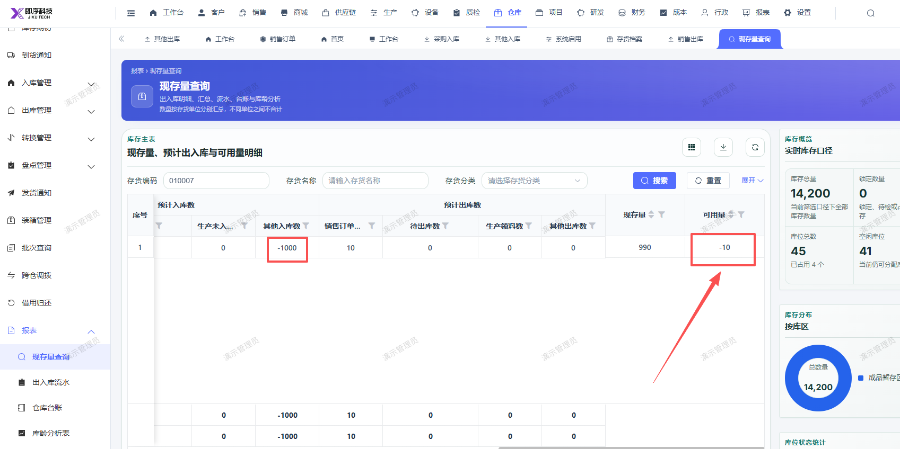

# 现存量报表可用量显示不对，应显示990（其他入库1000，销售出库10-已审核通过）

- **优先级**：P2
- **模块 / 页面**：仓库-报表-现存量报表
- **测试环境**：https://jixu-ai.com/wireSideWarehouse/reportForms/standingStock
- **提交时间**：2026-10-28 16:57:58（北京时间）
- **状态**：待修复

## 问题描述
现存量报表可用量显示不对，应显示990
其他入库1000，销售出库10-已审核通过，可用量应显示990

## 复现步骤
1，点击仓库
2，点击报表
3，点击现存量查询
4，搜索存货编码：010007
5，显示的可用量不对，应显示：990
该存货其他入库1000，销售出库10-已审核通过，可用量应显示990

## 实际结果

## 预期结果

## 截图

