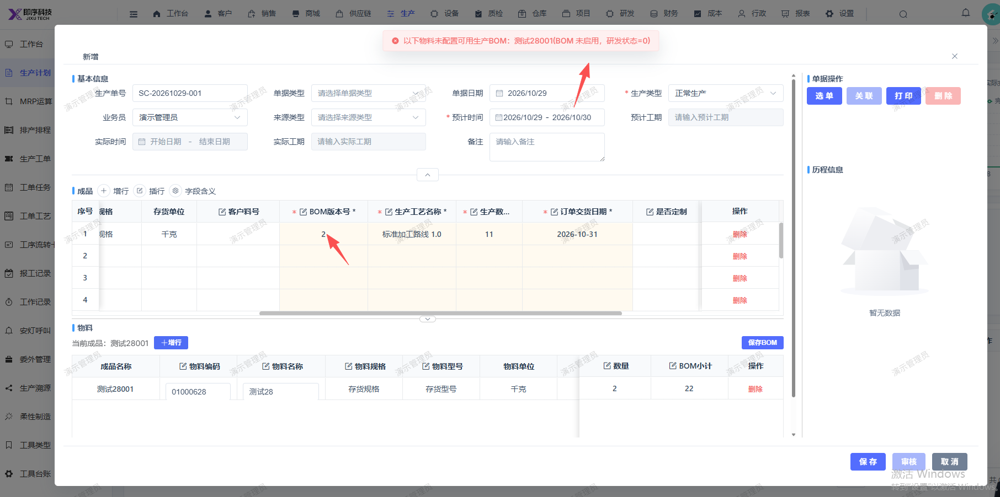

# 新建生产计划保存报错：以下物料未配置可用生产BOM：测试28001(BOM 未启用，研发状态=0)

- **优先级**：P1
- **模块 / 页面**：生产-生产计划
- **测试环境**：https://jixu-ai.com/mes/produce/order
- **提交时间**：2026-10-29 10:42:43（北京时间）
- **状态**：待修复

## 问题描述
新建生产计划保存报错：以下物料未配置可用生产BOM：测试28001(BOM 未启用，研发状态=0)

## 复现步骤
1，点击生产
2，点击生产计划
3，点击新增，在弹窗内选择存货名称，选择存货编码010007，点击确定
4，再点击保存，报错：以下物料未配置可用生产BOM：测试28001(BOM 未启用，研发状态=0)

## 实际结果

## 预期结果

## 截图

