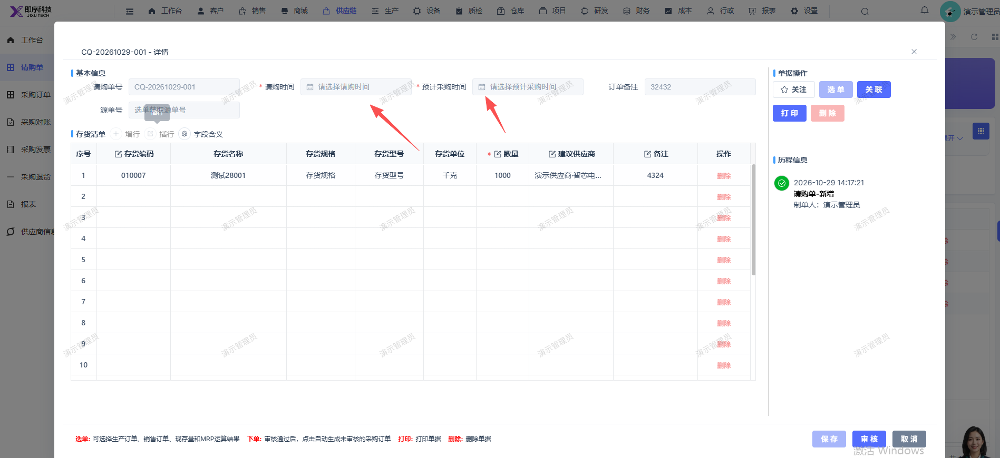

# 请购单保存后，请购单详情页面，请购时间和预计采购时间不显示

- **优先级**：P2
- **模块 / 页面**：供应链-请购单
- **测试环境**：https://jixu-ai.com/erp/purchase/purchaseRequest
- **提交时间**：2026-10-29 14:25:06（北京时间）
- **状态**：待修复

## 问题描述
请购单保存后，点击请购单号弹窗详情，请购时间和预计采购时间不显示，请购单号：CQ-20261029-001

## 复现步骤
1，点击供应链
2，点击请购单
3，点击 请购单号 ：CQ-20261029-001，请购时间和预计采购时间不显示

## 实际结果

## 预期结果

## 截图

