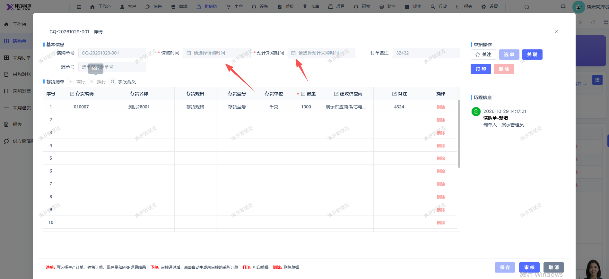

# 请购单保存后，请购单详情页面，请购时间和预计采购时间不显示

- **优先级**：P2
- **模块 / 页面**：供应链-请购单
- **测试环境**：https://jixu-ai.com/erp/purchase/purchaseRequest
- **提交时间**：2026-10-29 14:25:06（北京时间）
- **状态**：代码已修复，待发布

## 问题描述
请购单保存后，点击请购单号弹窗详情，请购时间和预计采购时间不显示，请购单号：CQ-20261029-001

## 复现步骤
1，点击供应链
2，点击请购单
3，点击 请购单号 ：CQ-20261029-001，请购时间和预计采购时间不显示

## 实际结果

## 预期结果

## 截图

## 状态同步（Qoder，2026-11-10）

- 产品提交：[前端 eb759f08b](http://192.168.110.240:3008/cfor_front/cfor-admin-vue3/-/commit/eb759f08bd164e6481129720316aa6c9d7fba0d7)
- 合入分支：dev/develop_5.0.1；本次已刷新远端并核对提交祖先关系（经合并提交 `480e6ca25` 进入）。
- 原因：详情接口返回的日期未转换为日期控件要求的格式，赋值后控件不回显。
- 修改：仅改两个请购单前端文件。`formDialog.vue` 读取详情后将 `orderTime`、`expectedOrderTime` 统一转为 `YYYY-MM-DDTHH:mm:ss` 再赋表单；`formDetail.vue` 对独立详情/审批嵌入入口做相同处理。使用既有 `formatToDateTime`，未改后端、数据库或配置。
- 既有验证及限制：本地测试单 CQ-20261107-001 详情两个日期正确显示，编辑表单正确回填，改预计采购时间为 2026-11-15 保存后重新加载与再次打开详情均保持该值。定向 ESLint、`@vue/compiler-sfc` 对两份真实源文件编译、`git diff --check` 通过；未运行全项目类型检查或全量构建。独立路由/审批嵌入详情入口只做同样代码修正与编译检查，未通过浏览器单独进入。保留测试单据及修改后的日期，未审核、未下单。
- 当前结论：代码已修复，待发布；尚无生产发布或修复后生产复测证据。
- 详细记录：[修改内容、验证及限制](reports/2026-11-10-bug-status-sync.md#bug-local-20261029142506-9df7700d)
